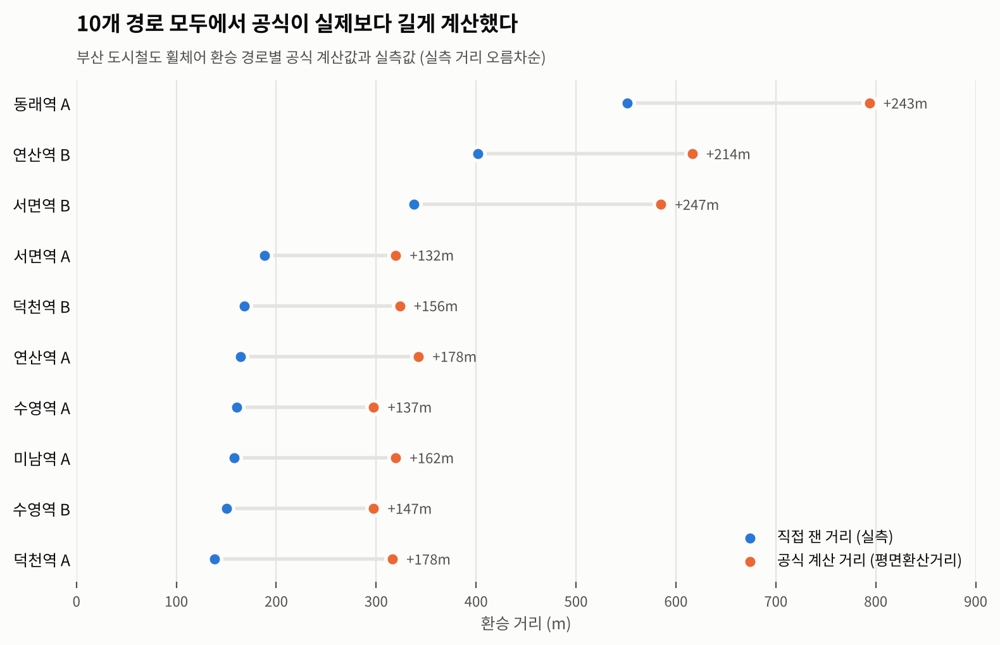

# 🚇 휠체어 이용자의 부산 도시철도 환승 거리 분석

> **공식이 예측한 환승 거리와 직접 잰 환승 거리는 얼마나 다를까?**
> 그리고 그 차이를 만드는 것은 안내 표지일까, 역의 구조일까?


| 항목 | 내용 |
|---|---|
| 기간 | 2025.06 – 2025.08 |
| 팀 | 3인 (사회학 · 미디어커뮤니케이션 · 통계학 전공) |
| 내 역할 | **공동 저자(2저자), 데이터 분석 전담** — 회귀·VIF 진단 후 주성분 분석(PCA) 도입 제안 및 수행 / 동래역 A, 서면역 A·B 현장 실측 |
| 대상 | 부산 도시철도 동일 역 환승역 **6곳**, 휠체어 환승 경로 **10개** |
| 결과 | 2025 대학생 논문경진대회 **최우수상** (주최 한국장애인재단 · 후원 보건복지부) |

---

## 1. 문제 정의

부산 휠체어 이용자는 다른 교통수단보다 지하철을 더 많이 이용하지만, 지하철이 편리하다고 답한 비율은 11.9%에 그칩니다(2023 교통약자 이동편의 실태조사).
기존 연구는 **시설이 있는지 없는지**를 세거나 법·제도를 다루는 데 그쳤고, 휠체어 이용자가 **실제로 얼마나 더 움직여야 하는지**를 잰 연구는 거의 없었습니다.

그래서 질문을 두 개로 나눴습니다.

1. 기존 공식(교통약자 평면환산거리)이 계산한 환승 거리는 실제와 얼마나 다른가?
2. 공식에 없는 요인 중 실제 환승 거리를 늘리는 것은 무엇인가?

## 2. 접근 방법

```
① 공식으로 계산        평면환산거리 = 189.6 + 0.67×평면거리 + 94.14×개찰구 + 235.29×리프트 + 85.79×엘리베이터
        ↓
② 현장에서 직접 측정    10개 경로를 직접 이동하며 거리 측정, 공식 값과 비교
        ↓
③ 차이의 원인 찾기      12개 항목 평가조사표 개발 → 회귀분석 → 다중공선성 확인 → PCA 후 재분석
        ↓
④ 숫자로 안 잡히는 것   역별 현장 기록(사진·특이사항)으로 정성 분석
```

### 데이터 수집에서 신경 쓴 점

- **경로를 3구간으로 쪼개서 측정** — ① 하차 칸 → 엘리베이터, ② 엘리베이터 대기·이동, ③ 엘리베이터 → 환승 열차 칸. 장애인 칸이 열차 양 끝에 있어 두 칸 기준 거리의 평균을 사용했습니다.
- **채점 기준을 측정 전에 정함** — 시설이 아예 없을 때 몇 점을 줄지, 개수형 항목을 어떻게 5점 척도로 바꿀지 미리 합의했습니다.
- **평가자 간 편차 조정** — 3명이 역을 나눠 1차 평가한 뒤, 기준이 어긋난 항목은 다시 논의하고 필요하면 **현장을 재방문**해 확인했습니다.
- **혼잡하지 않은 시간대에 측정한 이유** — 붐비지 않는 시간에도 이동이 어렵다면, 그건 혼잡이 아니라 **역 구조**의 문제라는 근거가 되기 때문입니다.

<details>
<summary><b>평가조사표 12개 항목 보기</b></summary>

| 기준 | 항목 |
|---|---|
| 환승 경로 안내성 | 환승 동선 안내 표시성, 엘리베이터 위치 안내 표시 |
| 환승 경로 복잡성 | 환승 동선 직선성, 엘리베이터 탑승 횟수, 개찰구 통과 횟수, 휠체어 리프트 이용 유무, 엘리베이터 접근성 |
| 환승 경로 안전성 | 엘리베이터 내부 넓이, 경사로 유무, 통로 폭, 바닥 상태, 승강장과 열차 간격 |

모든 항목은 점수가 높을수록 불편하도록 설계했습니다.
초안은 35개 문항으로 시작해 현장 적용 가능성과 중복을 기준으로 12개로 줄였습니다.

</details>

## 3. 결과

### 발견 1. 공식은 10개 경로 모두에서 실제보다 길게 계산했다



<details>
<summary><b>경로별 수치 보기</b></summary>

| 환승 경로 | 공식 계산 (m) | 실측 (m) | 차이 (m) |
|---|---:|---:|---:|
| 서면역 A | 319.6 | 188.0 | 131.6 |
| 수영역 A | 297.5 | 160.5 | 137.0 |
| 수영역 B | 297.5 | 150.5 | 147.0 |
| 덕천역 B | 323.6 | 168.0 | 155.6 |
| 미남역 A | 319.6 | 158.0 | 161.6 |
| 덕천역 A | 316.3 | 138.0 | 178.3 |
| 연산역 A | 342.4 | 164.0 | 178.4 |
| 연산역 B | 616.5 | 402.0 | 214.5 |
| 동래역 A | 793.7 | 551.0 | 242.7 |
| 서면역 B | 585.1 | 338.0 | 247.1 |

</details>

공식은 실측보다 1.4~2.3배 길게 나왔습니다. 공식만으로 시설 개선 우선순위를 정하면 판단이 틀어질 수 있다는 뜻입니다.

### 발견 2. 거리를 늘린 건 안내가 아니라 구조였다

회귀분석과 PCA 결과, **안내성·안전성보다 경로 복잡성(구조적 요인)**이 환승 거리와 더 강하게 연결됐습니다.
현장 기록을 보면 이유가 분명했습니다. 환승 거리가 길었던 동래역·서면역 B·연산역 B에는 모두 **이전 승강장에서 환승 승강장으로 바로 가는 엘리베이터가 없었습니다.**

- **동래역** — 연결 엘리베이터가 없어 개찰구를 나와 **역 밖 보도를 건너** 반대편 출입구로 다시 들어가야 함
- **서면역 B** — 휠체어 리프트와 엘리베이터를 모두 거쳐야 하고, 리프트는 혼자 수동 조작해야 함
- **연산역 B** — 대합실로 나가 개찰구를 두 번 통과해야 하고, 안내문의 '직원 호출 버튼'이 실제로는 없음

반대로 수영역·덕천역·미남역은 직행 엘리베이터가 있어 비교적 짧았습니다.

### 발견 3. 결론이 모형에 기대고 있는지 다시 확인했다

표본이 10개뿐이라 회귀 결과를 그대로 믿기 어려웠습니다. 그래서 `scripts/analysis.py`로 논문 결과를 재현한 뒤 두 가지를 추가로 점검했습니다.

| 점검 | 결과 | 의미 |
|---|---|---|
| 한 경로씩 빼고 예측 (LOOCV) | 조정 R² 0.986 → **교차검증 R² 0.831**, 평균 오차 38m | 설명력은 과대평가돼 있었지만, 처음 보는 경로도 어느 정도 예측함 |
| 모형 없이 순위상관만 계산 | **엘리베이터 탑승 횟수(ρ=0.81)**, 개찰구 통과 유무(0.70)가 가장 강함 | 회귀 없이 봐도 "구조적 요인이 핵심"이라는 결론은 유지됨 |

```bash
pip install pandas numpy scipy statsmodels scikit-learn
python scripts/analysis.py   # 논문 표 4·6 수치가 그대로 출력됩니다
```

### 제언

- 직행 엘리베이터가 없는 동래역·서면역·연산역 특정 경로에 엘리베이터 추가 설치
- 엘리베이터 하차 지점에 장애인 칸 방향 안내 표시 (6개 역 모두 없음)
- 엘리베이터 근처 휠체어 이용자 도움 요청 버튼 설치

## 4. 한계와 다시 한다면

이 분석의 약점을 숨기지 않고 정리합니다.

| 한계 | 왜 문제인가 | 다시 한다면 |
|---|---|---|
| **표본 10개, 변수 12개** | 표본보다 변수가 많아 일반 회귀가 수학적으로 성립하지 않음. 모든 변수의 VIF가 무한대로 나온 직접적인 이유 | 회귀 대신 경로별 구간 분해와 순위 비교 중심으로 분석하고, 회귀는 표본을 늘린 뒤 적용 |
| PCA 후 회귀도 탐색적 | 교차검증하면 R²가 0.986에서 0.831로 떨어짐. 논문의 설명력은 과대평가돼 있었음 | 결과는 "어떤 요인을 먼저 볼지" 우선순위로만 해석하고, 논문에도 교차검증 수치를 함께 보고 |
| 측정 방식 | 연구진이 비장애인이고 걸어서 측정, 엘리베이터 대기·이동은 100초로 가정 | 실제 휠체어 이용자와 동행 측정, 엘리베이터 대기 시간 직접 기록 |
| 시간대 고정 | 특정 시간대에만 측정해 혼잡도 변화를 반영하지 못함 | 출퇴근·평시 반복 측정 |

## 5. 프로젝트 발전 과정

교내 데이터분석 프로그램(우수상)에서 같은 주제로 기초 통계와 평면환산거리 계산을 먼저 진행했고, 그때 느낀 한계를 바탕으로 실측 비교와 평가조사표를 더해 논문으로 발전시켰습니다.

## 📁 레포 구조

```
├── README.md
├── data/
│   ├── transfer_distance.csv            # 경로별 공식 계산값 · 실측값 (논문 표 2)
│   └── evaluation_scores.csv            # 경로별 평가조사표 12개 항목 점수 + 실측 거리
├── scripts/
│   ├── analysis.py                      # 회귀 · VIF · PCA · 주성분 회귀 · 교차검증
│   └── plot_formula_vs_measured.py      # 위 비교 차트 생성
├── images/
│   └── formula_vs_measured.png
└── docs/
    ├── evaluation_form.pdf        # 평가조사표
    └── paper.pdf                  # 논문 본문
```
